*15e session du GT Batiment du CNIG animée par l'équipe RNB (Elisabeth, Ines & Félix) le 16 Octobre 2025*

# Participants

~34 personnes

* RNB

  * Elisabeth TALBOURDET-VILLE

  * Felix VEITH

  * Inès CHAIBI

* DGFip

  * Véronique FAYARD

  * Théo GREZE

* Géo Vendée

  * Rémi BEAURAIN

* CEREMA

  * Arnaud GALLAIS

* Métropole de Lyon

  * Christelle BRISA

  * Loic MATHIS

* Métropole de Nantes

  * Pierre SOULET

  * Camille AFANGNIKE

* Métropole de Toulouse

  * Paule DI FEDERICO

* Métropole de Strasbourg

  * Sébastien WEHRLE

* Agglo Compiègne

  * Florent VANHOUTTE

* Pays de Brest

  * G. SEAC'H

* CSTB

  * Régis HAUBOURG

  * Mathieu THOREL

  * Antoine BREITWILLER

* GRDF

  * Pierre NGUYEN TRONG

* IGN

  * Yélise AKOL

  * Jérémie LE JOLLEC

  * Thierry LALLEMANT

  * François CHIRIE

  * Frédérique WILLIAMS (BAN)

* Data ES (recensement des équipements sportifs et lieux de pratiques)

  * Julien PETIT

* CCR

  * Nathalie ORLHAC

* Autre

  * François LACOMBE

  * Aurélie MOTTE

  * Filipe Afonso (stonal)

  * Bastien TEIHOL (Keyros - BIM)

# Actualités RNB

## Vers l'officialisation

* Le code de la construction va être mise à jour pour officialiser

  * La création d'un identifiant unique de bâtiment

  * que les identifiants sont gérés par le RNB

  * les décrets/arrêté arriveront dans les prochains mois

  * la définition ne rentre pas dans la loi, mais ça pourra l'être dans le décret

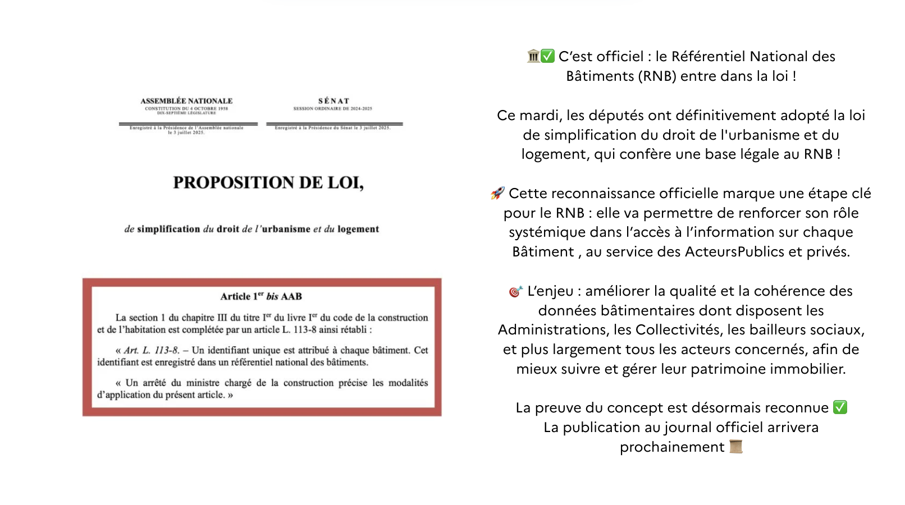

## Usages & applications

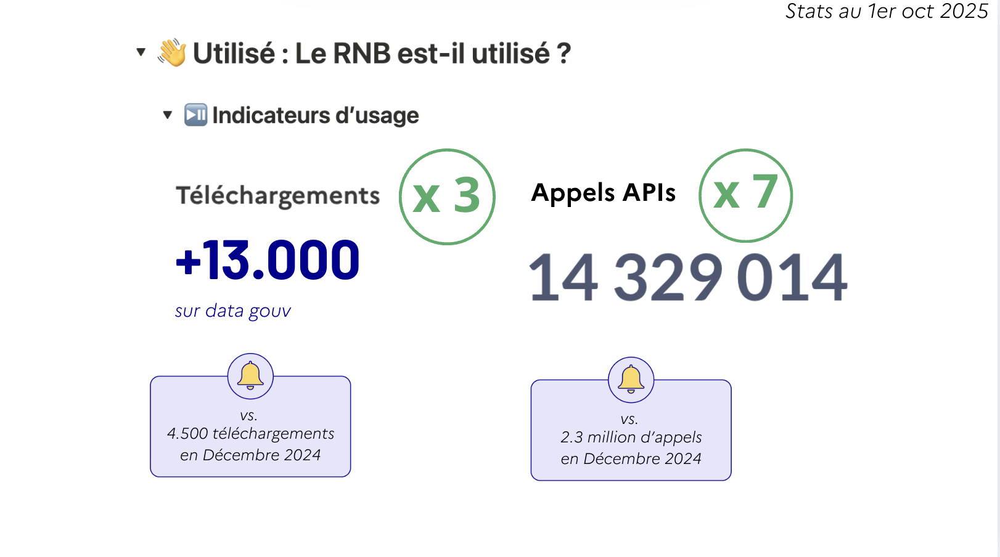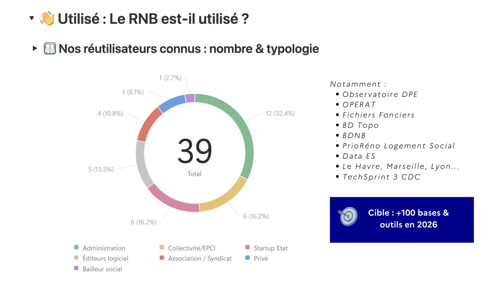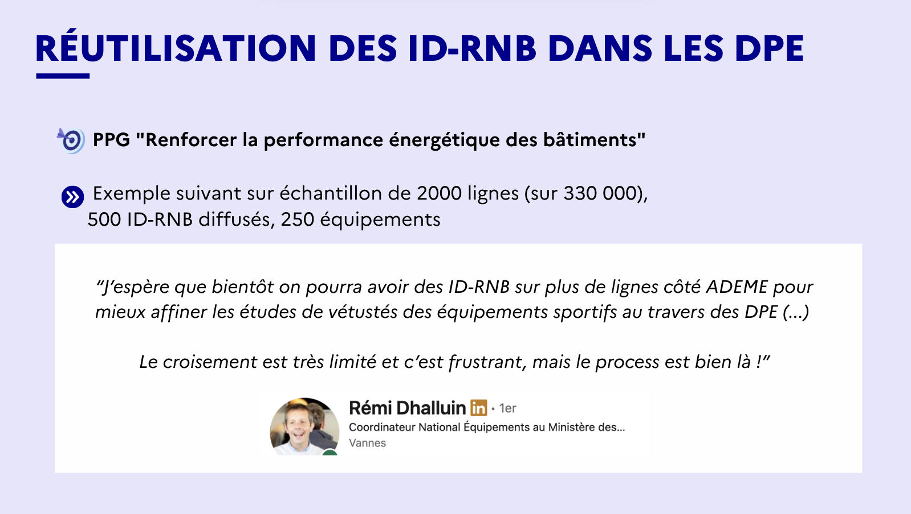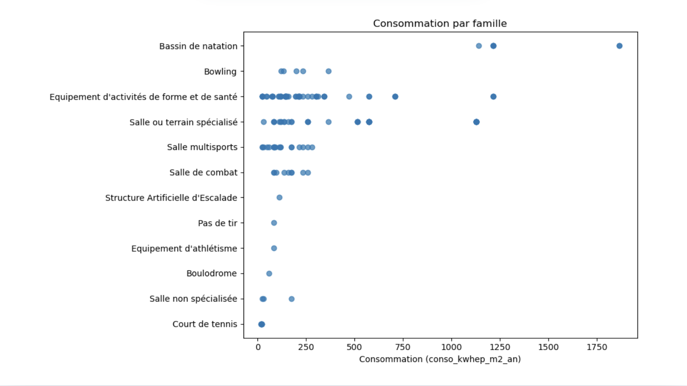

# Retex Editions du RNB sur la période estivale

* Métriques

  * 340 personnes inscrites

  * 90k contributions

  * des professionnels (collectivités, privé, bailleur, administration, privé...)

  * Plutôt des SIGistes

* Typologie des modifications

  * Update et en particulier des adresses, puis des formes

  * création

  * Merge

  * split

  * désactivation/réactivation

* Ex : le cas des géométries des Pyramides du Louvre, dans le RNB

* Question sur l'affichage (mise en visibilité) des bâtiments désactivés. Actuellement, ils ne sont visibles que dans l'API

* Retour d'expérience sur la qualité et l'audit qualitatif des contributions

* Sources des 4% d'erreurs

  * Pb de sémantique et de définition du bâtiment

  * Erreur de process: une partie dûe au fait qu'il n'y avait pas les fonction fusion /scission au début sur l'édition

Planches :

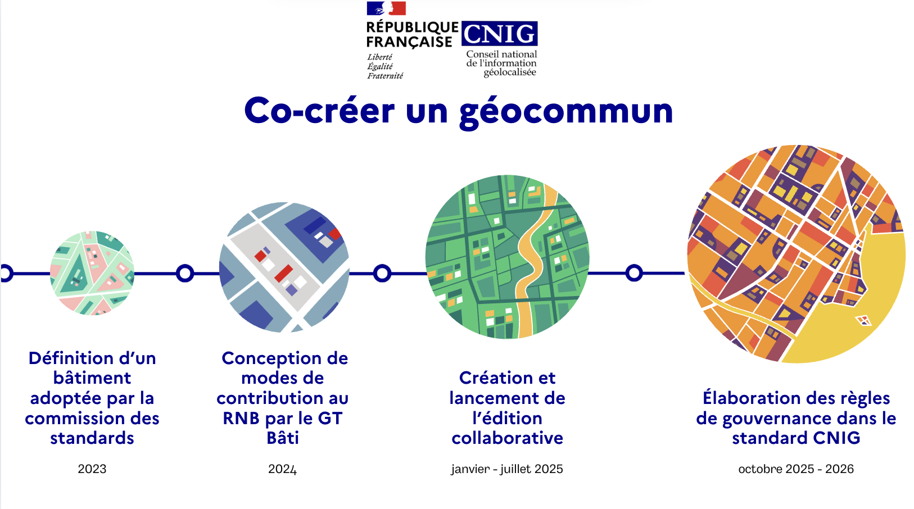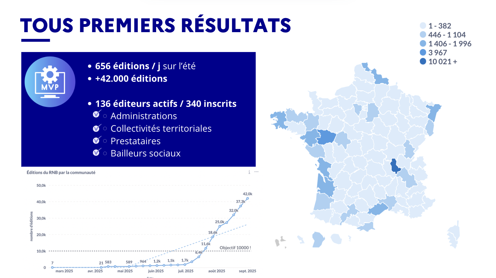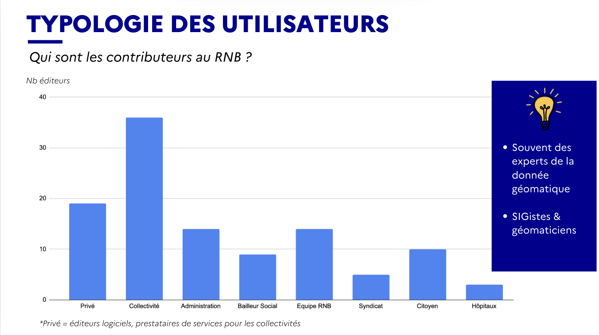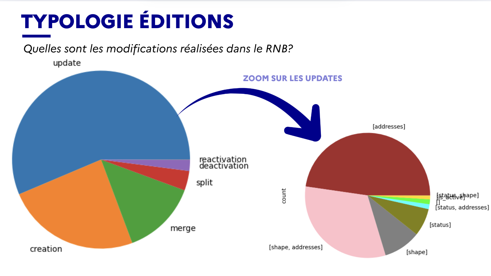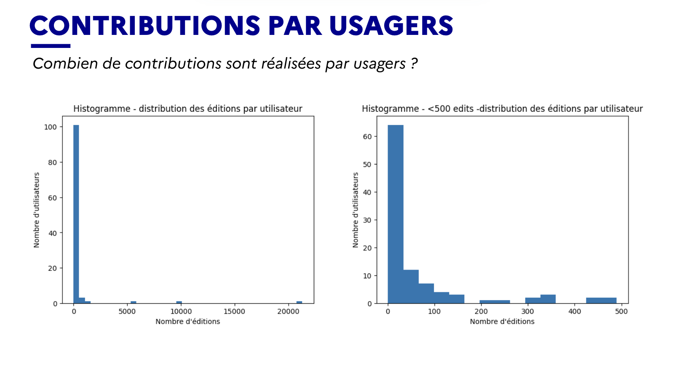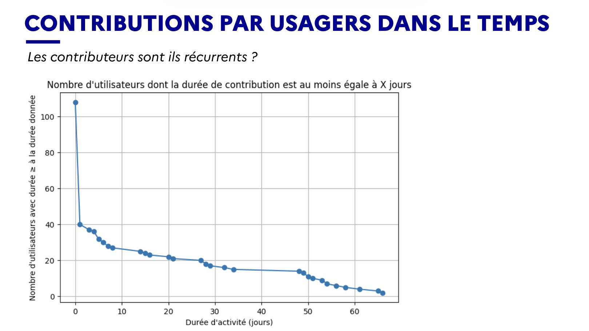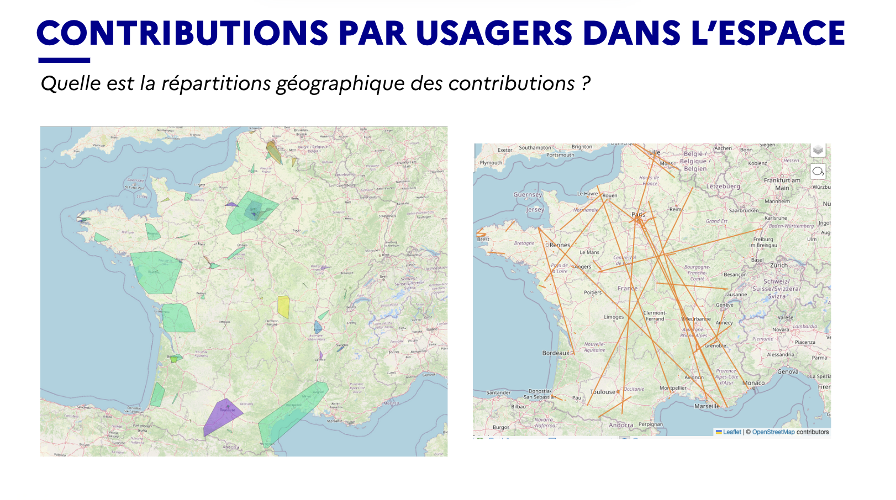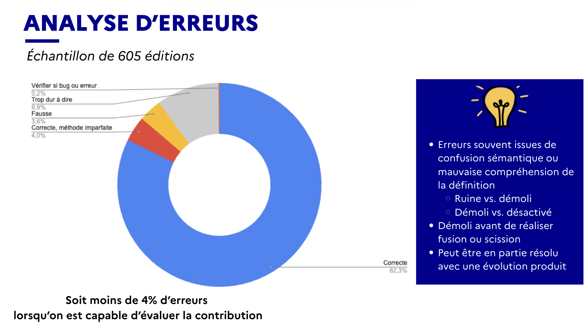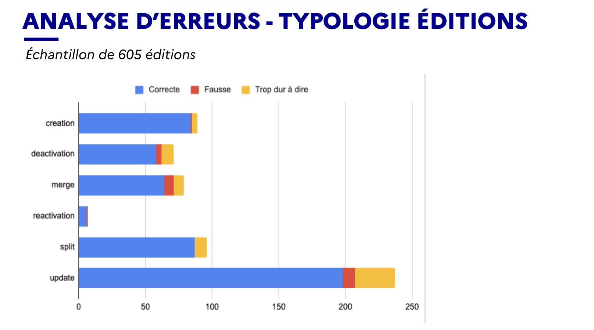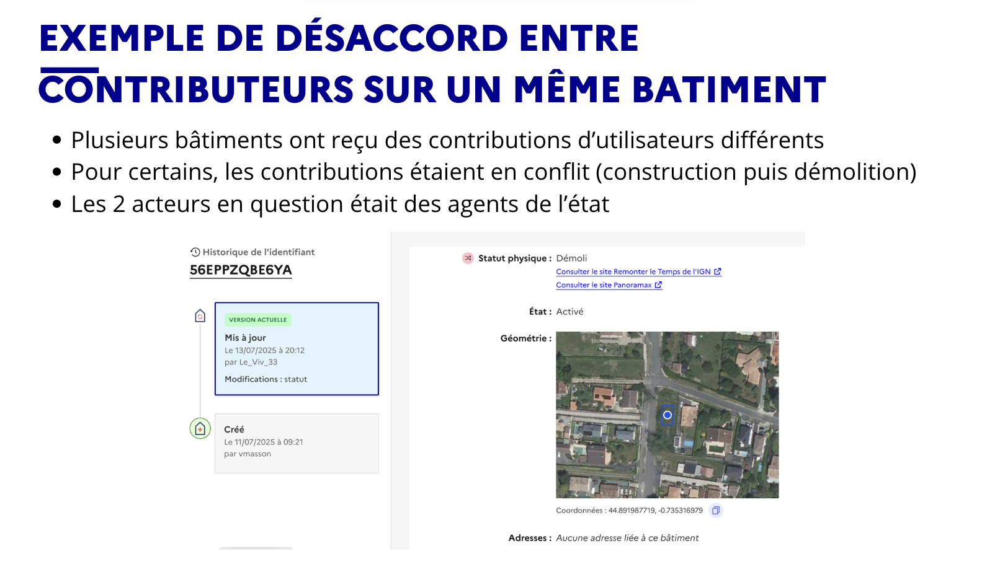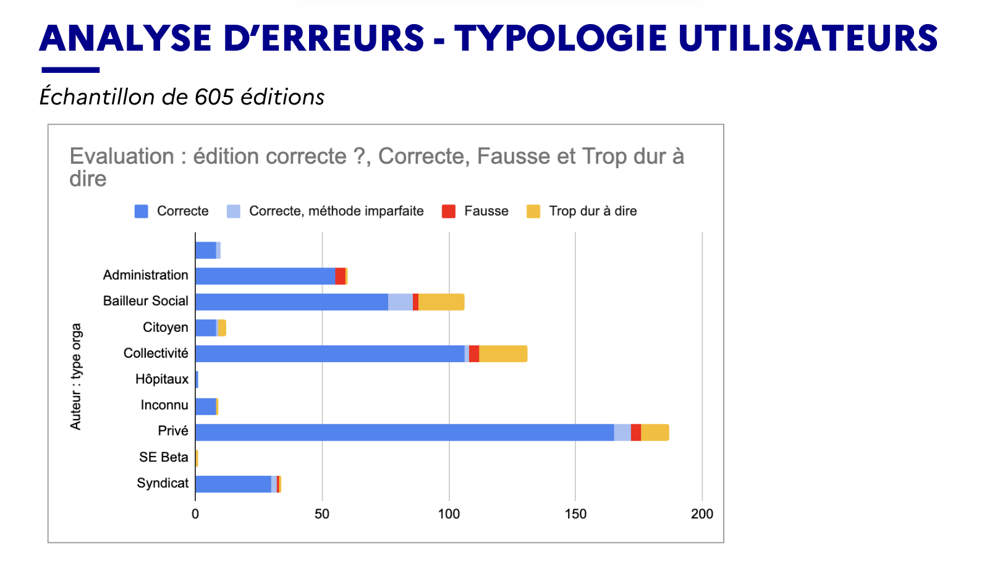

## Questions / réponses

* Est-ce que l'équipe RNB compte industrialiser les métriques d'évolution et d'évaluation des contributions présentées ?

  * Pas implémentées, mais en cours de réflexions. François Lacombe rappelle que des outils existent, et qu'une mutualisation serait une bonne chose

* Quid des modes de contrib (API vs Carto)

  * Plutôt l'API au début (à noter: carto non disponible à ce moment)

  * Mais massivement la carto

# GT : Atelier gouvernance

*Activité commune sur Mural d'idéation :*

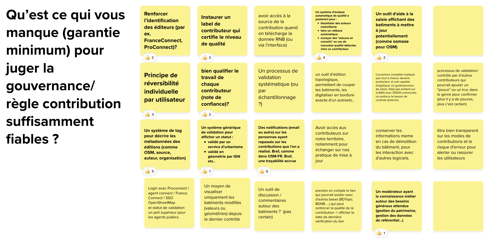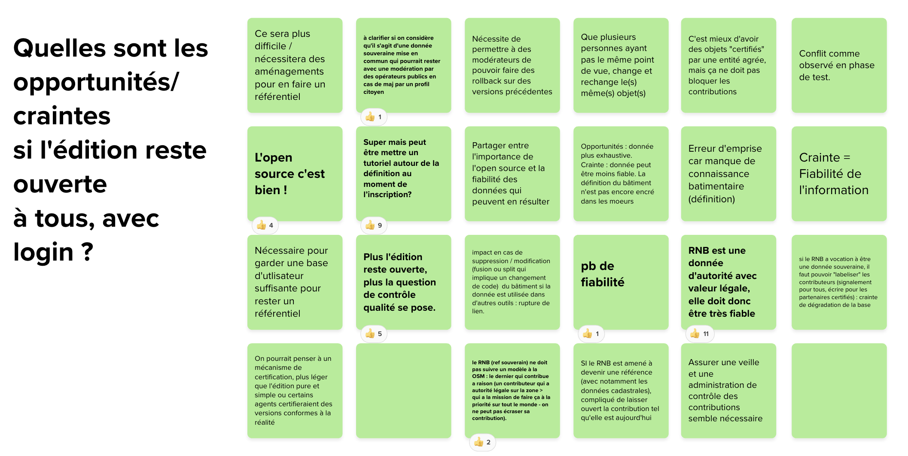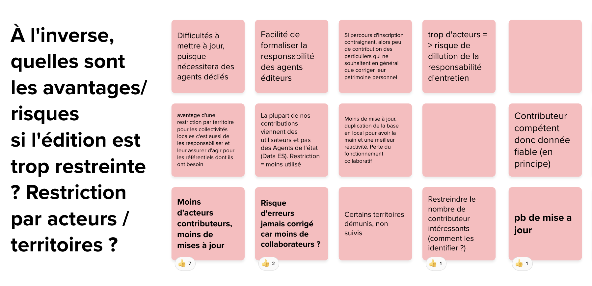

### Les principes faisant consensus

* **Principe** **1**: La donnée est **ouverte** à tous pour **contribuer** (c’est à dire modifier en base) les informations qu’il détient. Meilleure approche à ce jour pour l'assurer **l’exhaustivité** de la base, proche de la réalité terrain.

  * *A contrario,* la restriction du nombre d’utilisateurs autorisés à contribuer risque de mettre en péril le nombre d’informations collectées pour tenir à jour le référentiel

* **Principe 2:** Le RNB étant une **donnée de référence** pour les participants du CNIG (*mais* ajd seulement inscrit dans la loi, pas encore au sens du SPD V2)**:**

  * elle doit avoir un niveau de **qualité très élevée** (peu d’erreurs) pour être considérée **fiable** et assurer une **confiance.**

  * elle doit être **stable dans le temps & traçable** (pas de changements ou disparition d’ID-RNB)

* **Principe 3** : Le RNB est l’une des données géographique de référence mais doit être **en lien continu** avec les autres données géographiques équivalentes : la **parcelle**, **l’adresse** et le **local**

*Par ailleurs, les questions restantes :*

* Quelles sont les opportunités/craintes si l'édition reste ouverte à tous, avec login ?

  * **RNB est une donnée d'autorité avec valeur légale, elle doit donc être très fiable**

  * **Super mais peut être mettre un tutoriel autour de la définition au moment de l’inscription?**

  * **L'open source c'est bien !**

  * **Plus l'édition reste ouverte, plus la question de contrôle qualité se pose.**

* Qu'est ce qui manque pour la fiabilité

  * **Instaurer un label de contributeur qui certifie le niveau de qualité**

  * **Renforcer l’identification des éditeurs (par ex. FranceConnect, ProConnect)?**

  * **Un système de tag pour décrire les métadonnées des éditions (comme OSM, source, auteur, organisation)**

  * **Des notifications (email ou autre) sur les personnes ayant repassés sur les contributions que l'on a réalisé. Bref, comme dans OSM-FR. Bref, une traçabilité accrue**

- Freins actuels

  * **La préservation de la topologie des bâtiments scindés/créés avec leurs voisins**

  * **Bcp d'erreur lien RNB-BAN sur l'initialisation de 2023 qu'il faut purger (long)**

  * **Création d'un plugin QGIS**

## Echange suite au remplissage Mural:

Propositions pour la gouvernance

* '1 RNB ouvert et vivant, 1 RNB certifié en automatisant les tests; ils restent des tests à hautes valeurs (les faire faire par des gestionnaires de parc par ex)

* Utiliser le champ de démarche simplifiée et offrir aux users de pouvoir créer un batiment avec la position

* Rex contribution collaborative de Compiègne Agglo sur la donnée économique en région : la qualité était moins bonne dans les zones avec le plus de contributeurs (effet passager clandestin, un autre fera à ma place), et les zones avec le moins de contributeurs. Existence d'une taille critique qui assure la qualité sans verser dans trop de multicontribution > responsabiliser les autorités

* Certification finale par le propriétaire du bâtiment : les bâtiments sont souvent multi-propriétaires, ce serait extrêmement complexe

* Système d’indice de confiance par des validations d’acteurs de référence variés

* Plutôt modérer/ laisser place au contradictoire que filtrer les contributeurs

* Le moindre frein qui amènerait un délai entre la modification que fait un contributeur et son écriture dans le référentiel désengagerait la communauté

* bien mettre en rapport l'assemblage des referentiels entre eux (adresse, parcelle, bati, local) pour qu'on evite des raisonnements trop silotés. on a absolument besoin de maintenir la chaine de passage entre ces maillons pour les différentes politiques publiques

Proposition pour minimiser les changements des ID-RNB:

* En cas d'erreur (fusion etc par erreur qui crée un nouvel identifiant): typer la correction avec un tag 'rectification ID RNB' pour pouvoir facilement les identifier

## Conclusion - prochaines étapes

* Proposition de règles de gouvernance & débats asynchrone sur le canal dédié dans le Forum des Géocommuns : <https://forum.geocommuns.fr/t/regles-de-gouvernance-rnb/2883>

* Itération selon les commentaires / idées reçus pour orienter la feuille de route du RNB en 2026

* Rédaction du standard bâti CNIG en 2026
